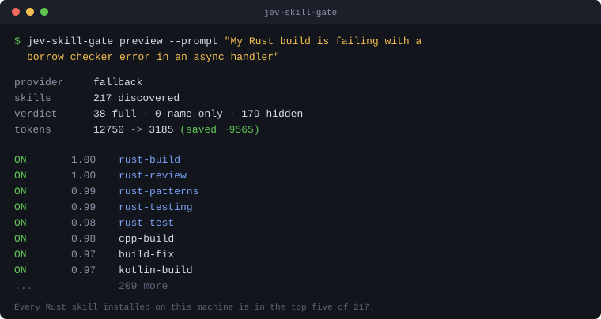

# jev-skill-gate

[](https://github.com/ShivamPansuriya/jev-skill-gate/releases)
[](test/run.mjs)
[](https://nodejs.org)
[](package.json)
[](LICENSE)

Claude Code loads every skill description into context at session start, whether or not the skill has anything to do with what you are working on. On a machine with a full skills library that is roughly 10,000 tokens spent before you type anything.

`jev-skill-gate` scores each skill against the project you are actually in, then writes `skillOverrides` so only relevant skills reach the model. Scoring runs on [TypeSafe's Jev](https://typesafe.ai), a decision model that returns calibrated probabilities instead of text, in one parallel pass over all your skills.



## Does it pick the right skills?

That is the only question that matters — a gate that saves tokens by hiding what you needed is worse than no gate. So there is a committed eval, not a claim.

**20 labeled cases · 217 installed skills · every label validated against the live inventory before the run.** Each case lists skills that *should* rank high and skills that are unambiguously irrelevant. State is the **prompt only**, with no project signals helping, which is the harder test.

| Metric | Jev (4 cases) | Local scorer (18 cases) |
| --- | --- | --- |
| Mean pairwise AUC | **1.000** | 0.961 |
| Cases with perfect separation | 4 / 4 | 14 / 18 |
| Median rank of an expected skill | **3** of 217 | 4 of 217 |
| Irrelevant skills reaching any top 10 | **0** | **0** |
| Expected skills surviving the gate | **100%** (19/19) | 92.9% |
| Skills hidden on a contentless prompt | **0** | **0** |

Different case counts, so these columns are not a head-to-head; the same-case
comparison is [below](#head-to-head-same-cases).

AUC is the share of (expected, irrelevant) pairs where the expected skill scored higher. 1.0 is perfect, 0.5 is a coin flip.

Reports: **[eval/RESULTS.md](eval/RESULTS.md)** · **[eval/COMPARISON.md](eval/COMPARISON.md)** · **[eval/JEV-PARTIAL.md](eval/JEV-PARTIAL.md)** · raw scores: [eval/raw-scores.json](eval/raw-scores.json) · cases: [eval/cases.json](eval/cases.json) · inventory: [eval/skills-inventory.tsv](eval/skills-inventory.tsv)

```bash
node eval/run-eval.mjs --local --fresh   # free, no key, ~2 seconds
node eval/run-eval.mjs --reuse           # re-derive every number from committed scores
node eval/compare.mjs                    # Jev vs local, same cases
node eval/run-eval.mjs                   # the Jev arm; resumable, needs credits
```

### Verdict: does Jev get the right skills?

**Yes, and it hid nothing.** Across the 4 cases scored against live Jev, all 19 labeled skills survived gating:

```
19 expected skills · 4 cases
  14  full description
   5  name-only  (Claude sees the name, not the description)
   0  hidden                    ← the number that decides it
```

| Case | Outcome | Best hit |
| --- | --- | --- |
| `django-api` | **6/6 at full description** | `django-patterns` 0.94 (#2 of 217) |
| `pr-review` | 4 full, 1 name-only | `perform-ai-code-review` 0.97 (#1) |
| `rust-borrow` | 3 full, 2 name-only | `rust-build` 0.95 (#1) |
| `freight` | 1 full, 2 name-only | `carrier-relationship-management` 0.96 (#1) |

Irrelevant skills landed at ranks 149–217 with scores of 0.01–0.03. **Pairwise AUC 1.000 on every case** — no labeled skill ever scored below an irrelevant one.

### Head to head, same cases

Restricted to the 4 cases both scorers ran — full report in **[eval/COMPARISON.md](eval/COMPARISON.md)**:

| | Jev | Local TF-IDF |
| --- | --- | --- |
| Mean pairwise AUC | **1.000** | 0.948 |
| Expected skills hidden | **0** | 1 |
| Cost per session | ~$0.0009 | $0 |

The gap is narrower than it looks, and the local scorer is not embarrassed. On `rust-borrow` and `pr-review` TF-IDF actually ranked the *worst* expected skill higher than Jev did (5 vs 38, and 24 vs 89). Where Jev clearly wins is semantic matching with no shared vocabulary: on the freight prompt it scored `inventory-demand-planning` 0.15 and kept it, while TF-IDF scored it **0.00** and hid it, because the words "freight" and "carrier" appear nowhere in that skill's description.

Over the full 18-case set the local scorer hid 5 labeled skills, all at exactly 0.00:

| Prompt | Skill it hid |
| --- | --- |
| "CMake build failing, template instantiation error" | `cpp-review` |
| "Audit this Laravel app for SQL injection" | `security-review` |
| "Write a blog post and adapt it for LinkedIn and X" | `x-api` |

**Honest read:** if your skill descriptions share vocabulary with how you phrase prompts, the free scorer is close enough — run it and skip the key. Jev earns the call when your library has skills whose names and descriptions do not literally overlap the words you type.

### What the data changed in this repo

The eval was not decoration; it moved two shipped defaults.

`nameOnly` was 0.25. Jev scored `rust-test` at **0.22** and `inventory-demand-planning` at **0.15** — both relevant, both would have been silently hidden. The threshold is now **0.15**, and `inventory-demand-planning` survives by a margin of exactly zero. Secondary-but-relevant skills consistently land in 0.15–0.35 while primaries sit at 0.82–0.97, so that band is where the recall is won or lost.

The weak-signal guard originally measured prompt *length*, which made a 10-word Rust prompt look as uninformative as "fix it". It now measures whether scores actually separate. Vague prompts hide **0** skills.

### Known limits of this evidence

- **4 of 20 cases** ran against Jev. The free tier allows roughly 4 requests per refill window; the rest are pending credits. Nothing is estimated to fill the gap.
- **"Survived" is not "fully visible."** A name-only skill gives Claude the name and no description to judge it by. 5 of 19 landed there.
- Labels are one person's judgment of what *should* match. On the Django prompt Jev ranked `security-review` #1 at 0.96 — correct, since the prompt says "check it for security holes", and the label was simply incomplete.

### How much is saved, and how

The saving is not a guess — it is the sum of the description tokens for every skill moved out of full visibility.

| | tokens |
| --- | --- |
| 217 discoverable skills, full manifest | **12,750** |
| after gating a Rust prompt | **3,185** |
| saved | **9,565 (75%)** |

Per skill, the three states cost:

| State | Cost | Claude sees |
| --- | --- | --- |
| `on` | full description, ~60 tokens | name + description |
| `name-only` | ~3 tokens | name |
| `user-invocable-only` | 0 tokens | nothing |

`/context` reports 9.9k for skills on this machine against the 12,750 estimated here; the estimator counts characters at 3.8/token and runs slightly high. The *savings ratio* is what transfers, not the absolute figure.

Cost to compute: **one Jev request per session**, 217 questions in a single parallel pass, ~17.7k input tokens, **$0.00074**, cached for 7 days.

### Tracking it over time

Every `apply` and every hook run is recorded, so the savings are measured rather than assumed. `preview` writes nothing, so reading a plan never inflates the numbers.

```
$ jev-skill-gate stats

  lifetime
    triggered      3 sessions  over 1 day
    tokens saved   30,253  ·  avg 10,084 per session
    manifest       12,750 -> 2,666 avg  (79% smaller)
    spent          $0.0009  ·  $0.03 per 1M tokens saved
    jev requests   1  ·  22,332 input tokens

  by provider
    fallback       2 runs   $  0.0000       18,425 saved
    gateway        1 runs   $  0.0009       11,828 saved
```

`$ per 1M tokens saved` is the number that decides whether the API call earns its place. `--json` for machine output, `--all` for the full run log, `--reset` to clear. The ledger lives at `~/.claude/jev-skill-gate/stats.json`; lifetime totals are kept separately from the run log, so trimming the log never loses history.

## What it actually changes

Claude Code's `skillOverrides` setting has four states. This tool maps a relevance score onto three of them:

| State | What Claude sees | In your `/` menu |
|---|---|---|
| `on` *(default, never written)* | name + description | yes |
| `name-only` | name only, ~3 tokens | yes |
| `user-invocable-only` | **nothing** | yes |
| `off` | nothing | hidden |

**It never writes `off`.** Hiding a skill from Claude is reversible by typing `/skill-name`; hiding it from you as well is not. A wrong call costs tokens you wanted to spend, never access.

## Install

Requires Node 18+. No dependencies.

```bash
git clone https://github.com/ShivamPansuriya/jev-skill-gate.git
cd jev-skill-gate
node bin/jev-skill-gate.mjs install
```

That registers a `SessionStart` hook in `~/.claude/settings.json`, merging into any hooks you already have.

Optionally set a key. Without one it uses a built-in local scorer and still works:

```bash
export AI_GATEWAY_API_KEY=vck_...   # via Vercel AI Gateway
export TYPESAFE_API_KEY=sk-...      # or TypeSafe direct
```

Or store it in the config file, which is written mode 0600:

```bash
jev-skill-gate config --provider gateway --api-key vck_... 
jev-skill-gate config --provider gateway --base-url https://my-proxy.internal
jev-skill-gate config                    # show current settings, keys masked
```

**An environment variable always wins over the config file.** Env is the better home for a credential: per-shell, easy to rotate, and it cannot end up in a file you commit by accident.

### Providers

Scoring is pluggable. Hosted Jev is the most accurate option; three open models run entirely on your own machine for nothing; and the local TF-IDF scorer needs no setup at all.

```bash
jev-skill-gate providers      # what is available and which one is selected
```

| id | What it is | Needs | Calibrated |
|---|---|---|---|
| `gateway` | TypeSafe Jev via Vercel AI Gateway | API key | yes |
| `typesafe` | TypeSafe Jev, called directly | API key | yes |
| `open-jev` | [Open-Jev](https://github.com/Zefan-Cai/Open-Jev), self-hosted HTTP server | a GPU for a large library | no |
| `laya` | [laya](https://github.com/NandhaKishorM/laya), 421M local Python model | `pip install laya` | no |
| `laya-mlx` | [laya-mlx](https://github.com/mizorewww/laya-mlx), MLX port | Apple Silicon | no |
| `fallback` | TF-IDF over names and descriptions | nothing | no |

All three were run for real — against the released Open-Jev-2B weights, against
`laya` on a full 217-skill library, and against `laya-mlx` on an Apple Silicon
Mac. The measurements, and the seven bugs those runs found, are in
[eval/LOCAL-PROVIDERS.md](eval/LOCAL-PROVIDERS.md).

**Calibrated matters.** A calibrated provider's 0.72 means the same thing on every prompt, so the `on: 0.6` threshold is a real control. An uncalibrated one only *ranks* skills, so the planner ignores thresholds for it and slices the top N instead. Getting this wrong hides skills silently, so every provider declares it and the default is `false`. If you measure your own reliability curve, override it per provider with `--set calibrated=true`.

#### Hosted Jev

```bash
export AI_GATEWAY_API_KEY=...        # or TYPESAFE_API_KEY
jev-skill-gate preview
```

`auto` picks whichever hosted provider has a key.

| | Vercel AI Gateway | TypeSafe direct |
|---|---|---|
| Endpoint | `POST {base}/v4/ai/evaluation-model` | `POST {base}/systemone` |
| Default base URL | `https://ai-gateway.vercel.sh` | `https://api.typesafe.ai/v1` |
| Model | `ai-model-id` **header** | `model` in the body |
| Primitive name | `boolean` | `noul` |
| Answer field | `probability` | `noul` |
| Default model | `typesafe-ai/jev` | `jev-latest` |

#### Open-Jev (self-hosted server)

The only one of the three open models that ships a server, so it is the one to reach for first. The model stays resident between calls.

```bash
python -m jev.server --checkpoint models/Open-Jev-2B/package/checkpoint --device cuda:0
jev-skill-gate config --provider open-jev            # defaults to http://127.0.0.1:8791
jev-skill-gate preview --prompt "fix my cargo build"
```

It takes the same `{state, questions}` body as hosted Jev. Batches are 16 skills, not 250, because each question is an independent forward pass rather than one parallel read.

**Throughput is the real constraint.** Measured on the released 2B checkpoint on CPU: about 4.5s per question on a short state, around 20s per question at a full project state. That makes a 217-skill library over an hour on CPU, so use a GPU for a library that size. On a small library, or on a GPU, it is comfortable.

No authentication: it binds to localhost and rejects cross-origin requests. Point `--base-url` at a reverse proxy if it needs to leave the machine, and set `--api-key` if that proxy wants one.

#### laya and laya-mlx (local process)

Neither ships a server — `laya` is a Python library, `laya-mlx` a one-shot CLI — so these providers run them as a subprocess and read JSON back. That means a model load per invocation, seconds rather than milliseconds on a 421M checkpoint. Tolerable because the gate runs once per session and caches for a week; if it is not, run Open-Jev instead.

```bash
pip install laya
jev-skill-gate config --provider laya
jev-skill-gate config --for laya --set python=/usr/bin/python3.11     # if python3 is not the right one
```

Measured on CPU: a 69 second model load, then about 0.48s per question at a flat 2.9GB. The full 217-skill library took 13m13s and cut 12,750 tokens to 2,087.

`laya-mlx` needs Apple Silicon and macOS 14+:

```bash
jev-skill-gate config --provider laya-mlx
jev-skill-gate config --for laya-mlx --set device=gpu
jev-skill-gate config --for laya-mlx --set command=uv --set args='["run","laya-mlx"]'
```

#### stuntd, and anything else that speaks the Jev protocol

[stuntd](https://github.com/bladedevoff/stuntd) serves `POST /v1/systemone` locally from the Laya checkpoint. It needs no provider here at all — point the `typesafe` provider at it:

```bash
stuntd serve                       # listens on 127.0.0.1:8787
jev-skill-gate config --provider typesafe --base-url http://127.0.0.1:8787/v1
TYPESAFE_API_KEY=local jev-skill-gate preview
```

Verified working against stuntd v0.1 with no code changes. A run against a loopback address is reported as costing nothing, whatever the provider's published rate, so a local proxy never inflates `jev-skill-gate stats`.

The same trick covers a corporate proxy in front of hosted Jev, or a mock in a test.

#### Adding your own

A provider is one file. Drop it in `~/.claude/jev-skill-gate/providers/` and it is selectable immediately — no edit to this repo, no registry to append to.

```bash
cp examples/providers/ollama.mjs ~/.claude/jev-skill-gate/providers/
jev-skill-gate config --provider ollama
```

The contract is in [`src/providers/spec.mjs`](src/providers/spec.mjs). The short version: declare `calibrated`, then implement **either** one HTTP request shape

```js
request({ questions, state, cfg, conf, apiKey }) -> { url, headers, body }
readAnswers(json, questions) -> Map<questionKey, probability>
```

— batching, retries, `Retry-After`, backoff and usage accounting are handled for you — **or** `score()` and own the whole flow, which is what the two `laya` providers do to drive a subprocess.

A plugin that throws at load time is reported and skipped. A provider that fails at run time degrades to the local scorer, so a dead key or an unreachable server can never leave a session with no skills.

`examples/providers/ollama.mjs` is a worked example against any Ollama chat model. It demonstrates the interface; it is not a recommendation, and the file says why.

## Use

```bash
jev-skill-gate doctor      # check setup, see what was discovered
jev-skill-gate preview     # score and show the plan, write nothing
jev-skill-gate apply       # write skillOverrides
jev-skill-gate stats       # lifetime tokens saved, cost, how often it ran
jev-skill-gate restore     # put skillOverrides back exactly as it was
jev-skill-gate uninstall   # remove the hook and restore
```

`preview` is the one to run first. It prints every skill with its score and the state it would get.

## How it decides

At `SessionStart` there is no user prompt yet, so relevance is judged against what the project *is*: detected stack, top-level layout, current branch, recent commit subjects, dependency names, and a README excerpt. That becomes the `state` for a single Jev call carrying one `noul` question per skill — all evaluated in parallel against one shared read.

Jev's probabilities are calibrated (trained with RLCD, which optimises probability against outcome rather than human preference), so a threshold is a meaningful control surface:

```
p >= 0.60  ->  on                   full description
p >= 0.25  ->  name-only            cheap breadcrumb
p <  0.25  ->  user-invocable-only  hidden from Claude, /name still works
```

Cost is about **$0.0005 per session** at $0.042/1M input tokens, and results are cached for 7 days keyed on a content hash of your skills plus the project signals.

## Safety behaviour

Hiding a skill is silent — Claude never learns it existed — so every ambiguous case fails open:

- **Thin signal bails out entirely.** An empty or brand-new directory produces almost no evidence, so nothing is hidden at all.
- **Unscored skills stay visible.** If the provider skips a question, that skill keeps its full description.
- **Provider failure degrades, never blocks.** A dead key, a timeout or a 500 falls through to the local scorer. A broken gate cannot stop a session from starting.
- **Your own overrides are never touched.** Anything you set by hand is recorded and preserved; only keys this tool wrote are rewritten.
- **`restore` is exact.** The original `skillOverrides` is snapshotted before the first run.
- **Bundled skills are never gated.** `/debug`, `/code-review` and friends live inside the Claude Code binary and cannot be enumerated from disk, so they are left alone.

## The local scorer

With no API key, a TF-IDF cosine ranker over skill names and descriptions runs instead. It is useful, and it is not Jev: it produces **ranks, not probabilities**. The planner knows the difference and switches from thresholds to a fixed top-N slice, because thresholding a rank is meaningless.

It is also worth running deliberately as a baseline. If it gets you 90% of the way on your own skill library, you do not need the API call.

## Configuration

Optional, at `~/.claude/jev-skill-gate.json`:

```json
{
  "provider": "open-jev",
  "providers": {
    "open-jev": { "baseUrl": "http://127.0.0.1:8791" },
    "gateway": { "model": "typesafe-ai/jev" }
  },
  "thresholds": { "on": 0.6, "nameOnly": 0.15 },
  "maxOn": 40,
  "maxNameOnly": 60,
  "alwaysOn": ["my-critical-skill"],
  "ignore": ["skill-to-leave-completely-alone"],
  "scope": "auto",
  "cacheTtlHours": 168
}
```

- `provider` — any id from `jev-skill-gate providers`, or `auto` (first hosted provider with a key) or `disabled`.
- `providers` — per-provider settings, merged over that provider's own defaults. An environment variable always beats an `apiKey` stored here, and the file is written `0600`.

- `alwaysOn` — kept at full visibility whatever the score.
- `ignore` — no override written at all.
- `scope` — `auto` writes project-local (`.claude/settings.local.json`) when you are in a project, user-level otherwise. Relevance is a property of the project, so project-local is usually right.

## Per-prompt gating

The manifest is built during skill discovery, before any prompt exists, and hooks can add context but never subtract it. So per-prompt gating cannot rewrite the manifest.

What the `UserPromptSubmit` mode does instead is surface skills that scored high for *this request* but are currently reduced, as `additionalContext`. Claude can still invoke them. Enable with:

```bash
node bin/jev-skill-gate.mjs install --event UserPromptSubmit
```

This appends to the user turn rather than the system prompt, so it does not invalidate the prompt cache. Run it alongside the `SessionStart` hook, not instead of it.

## Verified against

Claude Code v2.1.274. The mechanisms used — `skillOverrides`, `reloadSkills` on `SessionStart`, `enabledPlugins`, `installed_plugins.json` — are documented or stable on-disk formats. No binary patching: Claude Code ships as a compiled single-file executable whose JS lives in a string-constant pool, and it releases every few days.

## License

MIT
